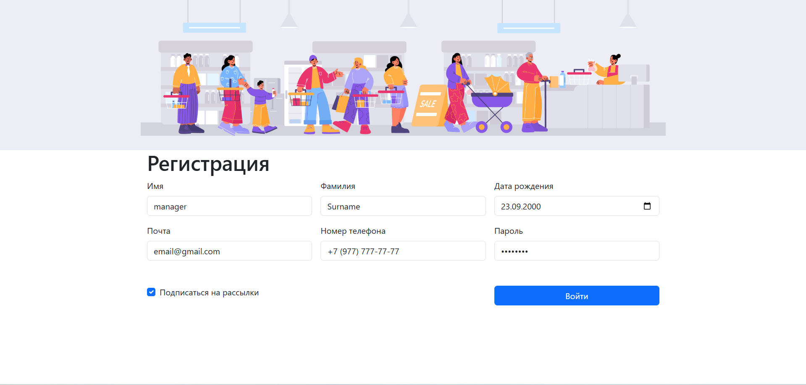
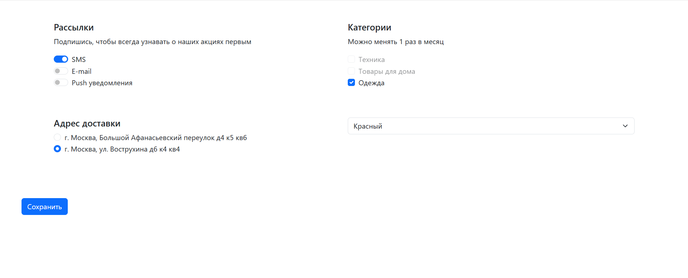
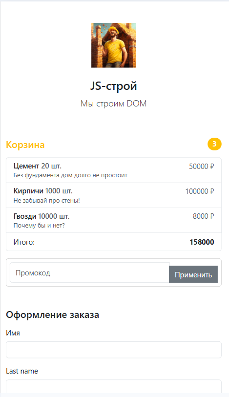

# Bootstrap User Profile

Две страницы личного кабинета пользователя на Bootstrap 5: регистрация и настройки профиля.

## Скриншоты





## Стек

- HTML5
- CSS3
- Bootstrap 5.3


## Что реализовано

### Страница регистрации (`index.html`)
- Поля: имя, фамилия, дата рождения, email, телефон, пароль
- Разные типы input: `text`, `email`, `date`, `password`
- Чекбокс «Подписаться на рассылки»
- Кнопка отправки формы
- Адаптивная сетка: 3 колонки на десктопе, 1 на мобильных

### Страница настроек (`settings.html`)
- Переключатели рассылок: SMS, E-mail, Push (form-switch)
- Категории товаров с состояниями `checked` и `disabled`
- Выбор адреса доставки через radio-кнопки
- Выпадающий список выбора цвета
- Кнопка «Сохранить»


## Как запустить

1. Клонирование репозитория:
   ```bash
   git clone https://github.com/anarkulovab/registration-settings-web